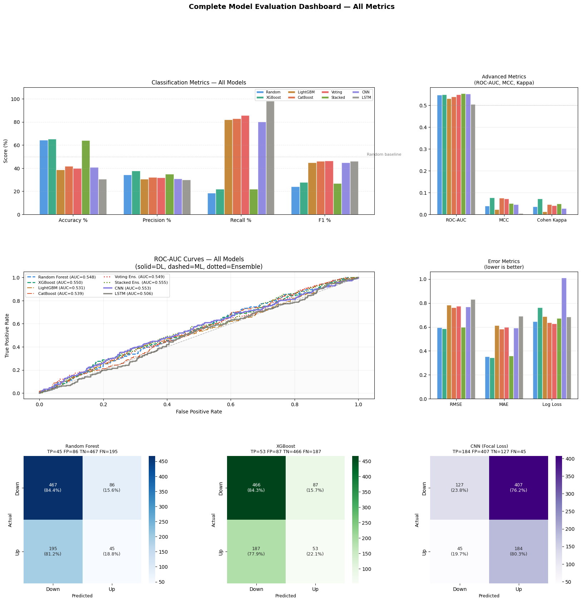
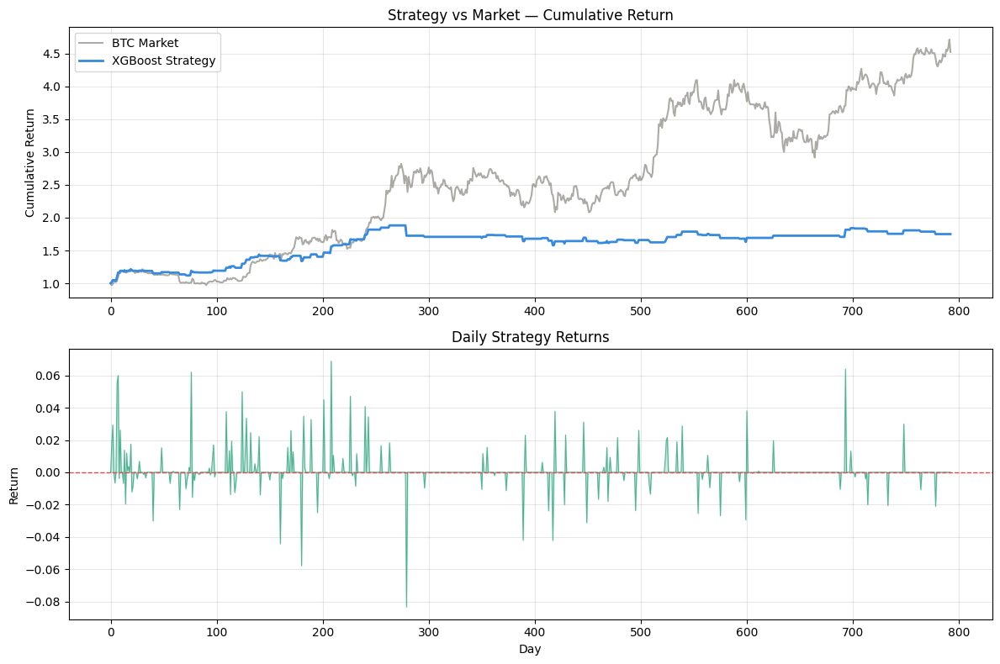

# ₿ Bitcoin Price Direction Prediction


Predicting whether **Bitcoin (BTC-USD) will rise more than 1% the next day** by combining technical indicators, **dual-channel news sentiment (TextBlob + FinBERT)** and the **Caldara & Iacoviello Geopolitical Risk (GPR) Index**. Eight models are compared, from gradient boosting to CNN/LSTM, under a strictly **leakage-free** pipeline.

---

## ✨ Highlights

- 🧠 **Dual sentiment:** general-purpose TextBlob polarity plus finance-specific **FinBERT** (`yiyanghkust/finbert-tone`) on financial news headlines
- 🌍 **Geopolitical risk:** daily GPR index with lagged (1/3/7-day) and high-risk regime features
- 🔒 **No data leakage:** chronological 70/10/20 split, scaler fit on training data only, **SMOTE applied to training data only** (including for 3D sequences)
- ⚖️ **Imbalance handling:** SMOTE, focal loss (γ = 2, α = 0.25), class weights, and decision thresholds calibrated on the validation set
- 🔍 **Explainability:** SHAP TreeExplainer attribution by feature group (technical / sentiment / GPR)
- 📈 **Backtesting:** long-only strategy driven by model signals, evaluated with a Sharpe ratio

---

## 📊 Results

Test set: the final 793 days (mid-2023 – Aug 2025), unseen during training.

| Model | Accuracy | Bal. Acc | Precision | Recall | F1 | ROC-AUC | MCC |
|---|---|---|---|---|---|---|---|
| **XGBoost (tuned)** | **65.45** | 53.18 | **37.86** | 22.08 | 27.89 | 0.550 | **0.077** |
| Random Forest | 64.56 | 51.60 | 34.35 | 18.75 | 24.26 | 0.548 | 0.040 |
| Stacked Ensemble | 64.06 | 52.18 | 35.10 | 22.08 | 27.11 | **0.555** | 0.051 |
| CatBoost | 41.74 | **53.39** | 32.10 | 82.92 | 46.28 | 0.539 | 0.076 |
| Voting Ensemble | 40.10 | 53.04 | 31.84 | 85.83 | **46.45** | 0.549 | 0.072 |
| CNN (Focal Loss) | 40.76 | 52.07 | 31.13 | 80.35 | 44.88 | 0.553 | 0.045 |
| LightGBM | 38.71 | 50.99 | 30.78 | 82.08 | 44.77 | 0.531 | 0.023 |
| LSTM (Focal + CW) | 30.80 | 50.06 | 30.04 | **98.25** | 46.01 | 0.506 | 0.004 |

**What the results show**
- 🌳 Tree-based models (XGBoost, Random Forest, Stacked) are the most reliable; deep sequence models over-predict "Up" on a dataset of this size.
- 🔬 SHAP attribution for XGBoost: **technical ≈ 72%**, **FinBERT sentiment ≈ 18%**, **GPR ≈ 10%**. Sentiment and geopolitical features add signal beyond price data.
- 🌍 XGBoost performs better during **high-geopolitical-risk** periods than low-risk ones.
- 💹 Backtest: **Sharpe ratio 1.20**, with a 1.75× cumulative return against 4.53× buy-and-hold during the 2023–25 bull run. The strategy stays out of the market most days, which lowers risk but misses much of the rally.

> ⚠️ **Honest take:** about 70% of test days are "Down/Flat", so accuracy alone is misleading. ROC-AUC ≈ 0.55 and MCC < 0.08 point to a **weak but non-random signal**, which is typical for next-day crypto direction. The main contribution is a rigorous, leakage-free evaluation framework, not a trading system.

<p align="center">
  
</p>
<p align="center">
  
</p>

---

## 🗂️ Data

| Source | Description |
|---|---|
| **BTC-USD daily OHLCV** | Via `yfinance`: 3,984 trading days, Sep 2014 – Aug 2025 |
| **Financial news headlines** | [Financial News Market Events Dataset 2025](https://www.kaggle.com/datasets/pratyushpuri/financial-news-market-events-dataset-2025) (Kaggle) |
| **Geopolitical Risk Index** | [Caldara & Iacoviello daily GPR](https://www.matteoiacoviello.com/gpr.htm): GPRD, GPRD_ACT, GPRD_THREAT |

**Target:** `1` if the next-day return is above +1%, otherwise `0` (class ratio ≈ 2 : 1).

---

## ⚙️ Pipeline

```
yfinance + News + GPR ─► Cleaning & merge ─► Feature engineering ─► Chronological split (70/10/20)
     ─► Min-Max scaling (train-fit) ─► SMOTE (train only) ─► 8 models ─► Threshold calibration ─► SHAP + Backtest
```

**Features**
- **Technical:** SMA-10/20, EMA-10, RSI-14, MACD, momentum, rolling volatility, lagged returns
- **Sentiment:** TextBlob polarity, FinBERT score, sentiment lags and change, sentiment × volatility interaction
- **Geopolitical:** GPRD, sub-indices, 7/30-day averages, lags, high-risk regime flag (> 90th percentile)

**Models**
- **ML:** Random Forest, XGBoost (GridSearchCV + TimeSeriesSplit), LightGBM, CatBoost
- **Ensembles:** Stacked (RF + XGB → Logistic Regression), Soft Voting
- **Deep learning:** 1D CNN and 2-layer LSTM on 30-day windows, tuned with Keras Tuner and trained with focal loss

---

## 🚀 How to Run

```bash
pip install yfinance pandas numpy scikit-learn imbalanced-learn xgboost lightgbm catboost tensorflow keras-tuner transformers textblob shap kagglehub matplotlib seaborn
```

Open `J G09 code.ipynb` in Jupyter, Kaggle or Colab and run all cells. A GPU is recommended for FinBERT and the deep learning models.

---

## 📁 Repository Structure

```
├── J G09 Dataset/              # news and GPR data files
├── J G09 code.ipynb            # full pipeline: data → features → models → SHAP → backtest
├── J G09 Paper.pdf             # research paper
├── J G09 Contribution Log.pdf
├── model_dashboard.png
└── backtest.png
```

📄 Full methodology, literature review and discussion are in the [paper](J%20G09%20Paper.pdf).
